# Juan Sebastián García C.

**QA Engineer · API & Integration Testing · Python · SQL**

Disponible para trabajo remoto · [LinkedIn](https://www.linkedin.com/in/juansgc)

Diseño pruebas de requisitos, APIs e integraciones, y automatizo su verificación con pytest,
Newman, Playwright y CI. Complemento con calidad de datos (ETL, SQL, conciliaciones), pruebas de
seguridad web (OWASP Top 10) y evaluación de sistemas que usan IA.

<picture>
  <source media="(max-width: 600px)" srcset="assets/terminal-movil.svg">
  
</picture>

**Demos en vivo:** [StoryLens QA](https://storylens-qa.onrender.com) ·
[Integrador de webhooks](https://integrador-webhooks-demo.onrender.com) ·
[Triaje de solicitudes](https://triaje-solicitudes-demo.onrender.com)

**Páginas de proyecto:** [NexusFlow](https://juansgarciac.github.io/nexusflow/) ·
[DataPulse](https://juansgarciac.github.io/datapulse/) ·
[StoryLens QA](https://juansgarciac.github.io/storylens-qa/)

Hosting gratuito: si nadie las visitó en los últimos 15 minutos, la primera carga tarda cerca de un minuto.

## Proyectos

Cada repositorio trae pruebas automáticas, CI en cada push y capturas del sistema real.

<table>
<tr>
<td width="50%" valign="top">

<h3>StoryLens QA</h3>
QA · requisitos y diseño de pruebas

Analiza historias de usuario antes de que se vuelvan defectos, genera casos de prueba trazables, organiza sesiones con evidencias y resume todo en métricas. Reglas deterministas siempre; la IA solo sugiere. Su página de presentación trae una demo que se usa sola: una historia vaga recibe 46 de 100 con cada hallazgo citado a ISO/IEC/IEEE 29148.

Python · FastAPI · React · pytest · Playwright

<a href="https://github.com/JuanSGarciaC/storylens-qa">Código</a> · <a href="https://storylens-qa.onrender.com">Demo</a> · <a href="https://storylens-qa.onrender.com/probar">Prueba tu historia</a> · <a href="https://juansgarciac.github.io/storylens-qa/">Presentación</a>
</td>
<td width="50%" valign="top">

<h3>Laboratorio de defensa</h3>
Seguridad · pruebas de ataque y endurecimiento

La misma aplicación web escrita dos veces, vulnerable y endurecida. Una consola de pentesting lanza siete ataques con su CWE (inyección SQL, XSS, recorrido de rutas, fuerza bruta, IDOR, redirección abierta y clickjacking) y enseña la terminal del atacante, el access.log, las peticiones al estilo DevTools y el diff que lo corrige. Una prueba objetiva dice qué ataque tuvo éxito y el informe se exporta. Los ataques no salen del proceso.

Python · FastAPI · React · pytest · Playwright

<a href="https://github.com/JuanSGarciaC/laboratorio-defensa">Código</a> · <a href="https://github.com/JuanSGarciaC/laboratorio-defensa#resultados-medidos">Resultados medidos</a>
</td>
</tr>
<tr>
<td width="50%" valign="top">

<h3>NexusFlow</h3>
Backend · automatización de procesos

Motor de workflows con pasos, condiciones y acciones contra APIs externas. Autenticación, RBAC, webhooks firmados, idempotencia, recuperación ante fallos y auditoría. Una página estática anima el cobro VIP: la pasarela responde 503, 503 y 201 a la misma Idempotency-Key y registra un solo cargo.

Python · FastAPI · PostgreSQL · Celery · Redis · React

<a href="https://github.com/JuanSGarciaC/nexusflow">Código</a> · <a href="https://github.com/JuanSGarciaC/nexusflow/blob/main/docs/demo.md">Guion de la demo</a> · <a href="https://juansgarciac.github.io/nexusflow/">Página del proyecto</a>
</td>
<td width="50%" valign="top">

<h3>DataPulse</h3>
Datos · ingeniería y calidad

Convierte CSV, JSON y una API REST paginada en datos confiables y trazables: ingesta validada con cuarentena, orquestación con Prefect, modelo estrella con dbt y conciliaciones que el CI verifica. El panel y la API suman validador de contratos en vivo, bandeja de cuarentena, linaje de un pedido hasta su archivo, caos en un clic con reintentos, frescura con SLA y tendencia de calidad; su página de presentación sigue seis registros reales por las capas.

Python · PostgreSQL · Prefect · dbt · Polars · Streamlit

<a href="https://github.com/JuanSGarciaC/datapulse">Código</a> · <a href="https://github.com/JuanSGarciaC/datapulse/blob/main/docs/QA_CASE_STUDY.md">Caso de estudio QA</a> · <a href="https://juansgarciac.github.io/datapulse/">Página del proyecto</a>
</td>
</tr>
<tr>
<td width="50%" valign="top">

<h3>Triaje de solicitudes (Sello)</h3>
IA aplicada · evaluación y revisión humana

Clasifica solicitudes de soporte de TI con un LLM y decide si se aprueban solas o pasan a una persona, con el motivo a la vista en cada tique. Suma «Prueba tu solicitud», plazos por prioridad, tablero por equipo, recorrido guiado de 60 s, métricas de la mesa, avisos firmados con HMAC y respuestas sugeridas. Evaluación con casos etiquetados.

Python · FastAPI · React · Gemini · pytest

<a href="https://github.com/JuanSGarciaC/triaje-solicitudes">Código</a> · <a href="https://triaje-solicitudes-demo.onrender.com">Demo</a> · <a href="https://triaje-solicitudes-demo.onrender.com/docs">API</a>
</td>
<td width="50%" valign="top">

<h3>Integrador de webhooks</h3>
QA · APIs e integraciones

Recibe webhooks de GitHub, valida la firma HMAC, los guarda y los entrega desde un worker. Idempotencia, reintentos con backoff y jitter, y cola de fallidos que una persona reprocesa. La vista «Cómo funciona» explica el recorrido paso a paso sobre el mismo lienzo al hacer scroll.

Python · FastAPI · React · pytest · Newman

<a href="https://github.com/JuanSGarciaC/integrador-webhooks">Código</a> · <a href="https://integrador-webhooks-demo.onrender.com">Demo</a> · <a href="https://integrador-webhooks-demo.onrender.com/docs">API</a>
</td>
</tr>
<tr>
<td width="50%" valign="top">

<h3>Cortex Agent</h3>
IA aplicada · agentes y evals

Harness de agente escrito a mano, sin frameworks: herramientas por MCP, RAG híbrido con citas, memoria de largo plazo y evals con juez, con vistas para ver cada paso del agente. El inicio muestra con una traza simulada cómo piensa un turno.

Python · FastAPI · TypeScript · React · SQLite · MCP

<a href="https://github.com/JuanSGarciaC/cortex-agent">Código</a>
</td>
<td width="50%" valign="top">

<h3>Datos abiertos de Colombia</h3>
Datos · pipeline y tablero

Descarga un dataset de datos.gov.co, lo valida, lo guarda en SQLite y genera un resumen cuyas cifras se concilian con la fuente. El tablero ejecuta el pipeline con un botón y dibuja su recorrido; el CI corre pytest y vitest.

Python · FastAPI · SQLite · React · pytest · vitest

<a href="https://github.com/JuanSGarciaC/datos-abiertos-colombia-educacion">Código</a>
</td>
</tr>
</table>

## Qué pruebo y cómo

| Área | Lo que hago | Dónde verlo |
|---|---|---|
| Requisitos | Reviso historias de usuario contra reglas citadas a su norma y derivo casos trazables | [StoryLens QA](https://github.com/JuanSGarciaC/storylens-qa) |
| APIs e integraciones | Firma HMAC, idempotencia, reintentos y permisos, con pytest y Newman | [Integrador de webhooks](https://github.com/JuanSGarciaC/integrador-webhooks) · [NexusFlow](https://github.com/JuanSGarciaC/nexusflow) |
| Contratos | El CI falla si el OpenAPI cambia sin regenerarse, y un job compara la simulación con la API pública real | [Integrador de webhooks](https://github.com/JuanSGarciaC/integrador-webhooks) · [DataPulse](https://github.com/JuanSGarciaC/datapulse) |
| Interfaz de punta a punta | Playwright contra el sistema real levantado en Docker | [StoryLens QA](https://github.com/JuanSGarciaC/storylens-qa) · [NexusFlow](https://github.com/JuanSGarciaC/nexusflow) · [Integrador de webhooks](https://github.com/JuanSGarciaC/integrador-webhooks) · [Triaje de solicitudes](https://github.com/JuanSGarciaC/triaje-solicitudes) · [Laboratorio de defensa](https://github.com/JuanSGarciaC/laboratorio-defensa) |
| Accesibilidad | axe en las pruebas de componentes y de punta a punta, contra WCAG 2.1 AA | [StoryLens QA](https://github.com/JuanSGarciaC/storylens-qa) |
| Carga y recuperación | k6 sobre ejecuciones concurrentes y límites de uso; copia de PostgreSQL con restauración verificada en el CI | [NexusFlow](https://github.com/JuanSGarciaC/nexusflow) |
| Calidad de datos | Validación con cuarentena, pruebas de dbt y conciliación de totales contra la fuente | [DataPulse](https://github.com/JuanSGarciaC/datapulse) |
| Seguridad web | Siete ataques del OWASP Top 10, cada uno con su CWE, automatizados contra una versión vulnerable y otra endurecida, con prueba objetiva de éxito (77 pruebas de backend y 22 en navegador) | [Laboratorio de defensa](https://github.com/JuanSGarciaC/laboratorio-defensa) |
| Seguridad en el CI | Auditoría de dependencias (pip-audit), análisis estático (Bandit), imágenes Docker (Trivy) y secretos en el historial (gitleaks) | [NexusFlow](https://github.com/JuanSGarciaC/nexusflow) · [DataPulse](https://github.com/JuanSGarciaC/datapulse) · [StoryLens QA](https://github.com/JuanSGarciaC/storylens-qa) |
| Sistemas con IA | Conjunto etiquetado a mano, métricas por clase, revisión humana, inyección de instrucciones y evals con juez | [Triaje de solicitudes](https://github.com/JuanSGarciaC/triaje-solicitudes) · [StoryLens QA](https://github.com/JuanSGarciaC/storylens-qa) · [Cortex Agent](https://github.com/JuanSGarciaC/cortex-agent) |

<picture>
  <source media="(max-width: 600px) and (prefers-color-scheme: dark)" srcset="assets/cobertura-oscuro-movil.svg">
  <source media="(max-width: 600px)" srcset="assets/cobertura-claro-movil.svg">
  <source media="(prefers-color-scheme: dark)" srcset="assets/cobertura-oscuro.svg">
  
</picture>

Cobertura medida en el CI: 94 % en el Integrador de webhooks, 91 % en DataPulse (mínimo exigido 90 %) y 88 % en el backend de NexusFlow (mínimo exigido 85 %).

## IA con respaldo y evaluación medida

En mis proyectos la IA no decide sola: hay un camino sin IA, una persona tiene la última
palabra en las decisiones y lo que hace el modelo se mide contra casos etiquetados a mano.

| Proyecto | Respaldo | Medición |
|---|---|---|
| [StoryLens QA](https://github.com/JuanSGarciaC/storylens-qa) | Reglas deterministas citadas a su norma; la IA solo sugiere y la persona acepta o descarta | En 13 historias no vistas: reglas F1 0,71; IA F1 0,37–0,46 en tres corridas |
| [Triaje de solicitudes](https://github.com/JuanSGarciaC/triaje-solicitudes) | Aprobación automática solo con confianza ≥ 0,75 y prioridad no alta; el resto va a revisión humana | Prueba final de 10 casos: categoría 90 % con Gemini frente a 60 % con reglas |
| [Cortex Agent](https://github.com/JuanSGarciaC/cortex-agent) | La búsqueda y los evals de retrieval funcionan sin modelo; cada paso del agente queda en una traza consultable | Eval de agente con juez: de 5 a 6 casos de 6 según el modelo y la corrida (Gemini y un modelo local); recall@k y MRR en el CI |

También publico lo que salió mal: en StoryLens la evaluación destapó un bug que descartaba
hallazgos correctos, en Triaje la confianza del modelo resultó poco calibrada y Cortex Agent
quedó sin probar con la API de Claude.

## Stack

- **Pruebas**: pytest · Postman/Newman · Playwright · Vitest · Testing Library · axe · k6
- **Calidad de código**: Ruff · mypy · ESLint · cobertura con mínimo exigido en el CI
- **Seguridad**: OWASP Top 10 · pip-audit · Bandit · Trivy · gitleaks
- **Backend y APIs**: Python · FastAPI · Celery · Redis · OpenAPI
- **Datos**: SQL · PostgreSQL · SQLite · dbt · Prefect · Polars
- **IA**: Gemini · Ollama · MCP · RAG híbrido (BM25 y vectores) · evals con juez
- **Frontend**: React · TypeScript · Vite · Streamlit
- **Observabilidad**: Prometheus · Grafana
- **Entrega**: GitHub Actions · Docker · Docker Compose

## Contacto

[LinkedIn](https://www.linkedin.com/in/juansgc) · Disponible para trabajo remoto

---

El código de estos repositorios se publica para consulta. Todos los derechos reservados: su uso, copia o distribución requiere mi autorización por escrito.
